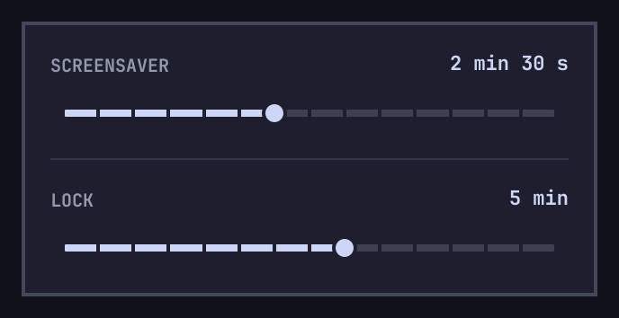

# omarchy-idle-timer

An [Omarchy](https://omarchy.org) bar widget: an icon with a popup holding two
sliders, one for the screensaver timeout and one for the lock timeout.



Drag a slider to preview the value; release it to save. The stops run from
15 s to 60 min: 15, 30, 45 s, 1, 1.5, 2, 2.5, 3, 5, 10, 15, 20, 30, 45 and 60 min.
The icon's tooltip shows both values. Esc closes the popup.

## Requirements

- Omarchy 4.5.0 (tested). The widget reads and writes the `idle` block of
  `~/.config/omarchy/shell.json`, which Omarchy's own idle service uses.

## Install, update, uninstall

```bash
omarchy plugin add https://github.com/jordi-adame/omarchy-idle-timer.git --enable
omarchy plugin update io.github.jordi-adame.idle-timer
omarchy plugin remove io.github.jordi-adame.idle-timer
```

Removing the widget leaves the timeouts you set in `shell.json`.

## What it writes

Releasing a slider writes `idle.screensaver` and `idle.lock` (seconds) in
`~/.config/omarchy/shell.json`, through Omarchy's own `omarchy-shell-config`
helper (jq, temp file, rename, shell config reload). Other keys are kept.
Then it restarts Omarchy's idle service (`omarchy-shell idle disable`, then
`enable`), because a running idle monitor does not pick up a new timeout.
While Stay Awake is on there is no restart, so Stay Awake stays on.

Nothing is written when the widget loads or the popup opens, and nothing else
is read or written. No network.

**Lock is never shorter than screensaver**, so the screensaver always comes
first: a screensaver above the lock moves the lock up to it, and a lock below
the screensaver moves the screensaver down to it.

With no `idle` block, the popup shows Omarchy's defaults: 2 min 30 s and 5 min.
A timeout of `0` means that action is off, as in Omarchy: the popup shows Off,
and moving the other slider keeps it off. Moving its own slider turns it on.

## Command line

```bash
omarchy-shell io.github.jordi-adame.idle-timer toggle   # also open, close
omarchy-shell io.github.jordi-adame.idle-timer set 300 600   # screensaver, lock in seconds
```

`set` keeps lock >= screensaver too.

## Known limits

- Only the stops above. A value between stops, set by hand, shows at the
  nearest stop, and is kept until you move that slider.
- Each save restarts the idle service, which starts the idle countdown again.
- A second release while a save is still running is dropped.
- English only.

See [CONTRIBUTING.md](CONTRIBUTING.md). License: [MIT](LICENSE).
